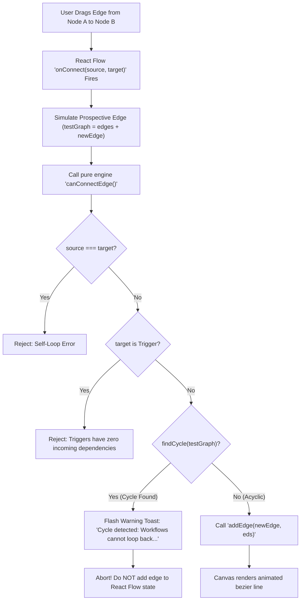

# Study Guide 03: Visual Canvas Workflow Editor & Client-Side Cycle Rejection

> **Target Audience:** Nikhil & Madhav (WEBSTER 2026)  
> **Topic:** Phase 3 Visual Canvas Builder (Part B) & Flow Persistence  
> **Primary Owner:** Nikhil (Visual Editor & Client Graph Engine) / Madhav (Backend Flow API)  
> **Key Concepts:** React Flow (`@xyflow/react`), Custom Node Handles, Inspector Slide-Over, Client-Side Cycle Prevention (`canConnectEdge`), Real-Time Topological Invariants, Starter Presets, Resilient API Client.

---

## 1. What Was Built & Why It Exists

In **Phase 3 Part B**, we transitioned **The Dormammu Loop** from pure mathematical algorithms into an interactive, visual workflow design studio:
1. **Interactive Canvas (`@xyflow/react`):** A pan-and-zoom dark-themed infinite canvas where users can visually design workflow DAGs by placing nodes and connecting dependencies with animated bezier edges.
2. **5 Custom Specialized Nodes:**
   - `trigger`: Initial event (manual, webhook, cron). Displays **only an output handle** (no incoming edges allowed).
   - `http`: REST API caller with method selector (`GET`, `POST`, `PUT`, `DELETE`), target URL, headers, and body.
   - `transform`: Template string interpolator (e.g. `"Order {{ trigger.orderId }} confirmed"`).
   - `delay`: Non-blocking pause timer (1–60 seconds) with interactive slider.
   - `output`: Result sink with custom storage keys.
3. **Draggable Node Palette:** A docked left-hand sidebar supporting both single-click node placement and HTML5 drag-and-drop onto canvas coordinates using `screenToFlowPosition`.
4. **Interactive Inspector Panel:** A right-hand slide-over panel that opens upon selecting any node, exposing typed inputs, live JSON headers validation, and instant synchronization with React Flow state.
5. **Zero-Latency Client-Side Cycle Prevention (`canConnectEdge`):**
   - In React Flow's `onConnect` and `isValidConnection`, the client runs our Phase 2 DFS back-edge detection algorithm **before** an edge is committed to state.
   - Self-loops ($A \to A$) and transitive cycles ($A \to B \to C \to A$) are rejected in **0 milliseconds**.
   - If an edge would create an infinite loop, the canvas refuses the connection and immediately flashes an alert toast: *"Cycle detected: Workflows cannot loop back on themselves ($A \to B \to C \to A$)"*.
6. **Canvas Action Bar:** Inline workflow naming, starter template presets (E-Commerce Pipeline, Diamond Branching, Delayed Webhook), client/server DAG validation with structured banners, PostgreSQL persistence, and a disabled Phase 4 Run button.
7. **Client API Layer & Multi-Page Routing:** `react-router-dom` multi-page navigation (`/` Flow List, `/flows/new`, `/flows/:id`) with typed API fetchers and an automatic offline fallback to `localStorage`.

---

## 2. In-Depth Technology Trade-Offs vs Alternatives

### Trade-Off 1: React Flow (`@xyflow/react`) vs HTML5 Canvas / SVG vs Cytoscape.js vs D3.js

| Technology | Pros | Cons | Why We Chose React Flow |
|---|---|---|---|
| **React Flow (`@xyflow/react`)** *(Chosen)* | 1. Native React component tree (nodes are standard React JSX with full Tailwind support).<br>2. Built-in pan, zoom, minimap, background grid, drag-and-drop, and connection handles.<br>3. Fast DOM reconciliation; custom HTML inputs inside nodes just work. | Bundle size (~400KB minified). | Perfect match for modern React workflow builders (used by Langflow, Airflow UI, n8n). Allows beginners to style nodes with simple Tailwind classes instead of low-level canvas drawing calls. |
| **Vanilla HTML5 `<canvas>`** | 1. Extremely fast for 100,000+ particles.<br>2. Zero bundle overhead. | 1. No DOM tree: you must manually code click hit-boxes, text rendering, input fields, zooming, and bezier curves from scratch.<br>2. High maintenance burden. | Overkill and painful to implement form controls (dropdowns, inputs) inside a raw canvas context. |
| **D3.js (Data-Driven Documents)** | 1. Unmatched mathematical power for scientific visual charts. | 1. Imperative DOM manipulation clashes directly with React's declarative state model.<br>2. Huge learning curve for custom interactive drag/connect handles. | D3 is designed for static or animated data visualization, not two-way editable diagram builders. |
| **Cytoscape.js** | 1. Built-in graph theory algorithms (shortest path, clustering). | 1. Canvas-based styling with custom stylesheet language.<br>2. Hard to embed rich React interactive inputs directly into node cards. | We already have our own pure, battle-tested graph engine (`backend/src/engine`), so we don't need Cytoscape's heavy algorithm bundle. |

---

### Trade-Off 2: Client-Side Cycle Rejection vs Server-Only Validation

- **The Problem:** When a user draws an edge between two nodes on a canvas, should the client check for cycles immediately, or wait until the user clicks "Save" and let the server respond?
- **Why We Reject on the Client (`canConnectEdge`):**
  - **Instant Feedback (0ms):** Users receive immediate haptic/visual feedback the moment they release their mouse cursor. If an edge is invalid, it bounces off instead of leaving the canvas in a broken state.
  - **Eliminates Form Frustration:** Nothing is worse than designing a 20-node graph for 10 minutes only to have the server reject the entire diagram on save.
- **Why We Still Keep Server Validation (`validateGraph`):**
  - **Defense-in-Depth:** A malicious user or script calling `POST /flows` directly via cURL or Postman could bypass frontend code entirely. The server remains the ultimate authority (returning HTTP 422 for cyclic graphs).

---

### Trade-Off 3: Controlled vs Uncontrolled Node State

- In React Flow, nodes and edges can be managed as:
  1. **Controlled State (`useNodesState`, `useEdgesState`):** React owns the array in state. Every drag, move, selection, or text edit updates the React state and triggers a render.
  2. **Uncontrolled State:** React Flow stores positions internally and only exposes getter methods (`rfInstance.toObject()`).
- **Our Decision:** We use **Controlled State with `useNodesState` and `useEdgesState`**.
  - **Why:** The Inspector Panel and Action Bar need to immediately read and modify node configs (e.g., updating an HTTP URL or changing a Delay duration) without requiring an explicit "Apply" button. Controlled state ensures the canvas preview and inspector panel are always 100% synchronized.

---

### Trade-Off 4: Type-Specific Inspector Forms vs Generic JSON Schema Renderers

- **Alternative:** Use `react-json-schema-form` to auto-generate forms from a JSON schema.
- **Why We Built Custom Tailored Form Components:**
  - Generic schema forms produce clunky, repetitive, unstyled inputs with poor usability.
  - Custom React components allow specialized, beginner-friendly UX:
    - Delay uses a real-time slider with instant second readout.
    - HTTP Request has a color-coded method dropdown (`GET` green, `POST` blue, `DELETE` red).
    - Transform node has interactive variable syntax help cards showing `{{ node.field }}`.
    - Trigger nodes show informative badges explaining that root triggers have zero dependencies.

---

## 3. File-by-File Breakdown with Beginner Analogies

| File | What It Does | Beginner Analogy |
|---|---|---|
| [`frontend/src/engine/types.ts`](file:///m:/dormammu-loop/frontend/src/engine/types.ts) | Defines `GraphNode`, `GraphEdge`, `Graph`, `NodeType`, and `ConnectionValidationResult`. | The **Lego specification sheet**. Defines which pieces fit together. |
| [`frontend/src/engine/graph.ts`](file:///m:/dormammu-loop/frontend/src/engine/graph.ts) | Pure algorithms: Kahn's topological sort, DFS cycle isolation, validation, and `canConnectEdge`. | The **Bouncer at the Door**. Inspects every new connection before letting it onto the canvas. |
| [`frontend/src/components/canvas/nodes/NodeCard.tsx`](file:///m:/dormammu-loop/frontend/src/components/canvas/nodes/NodeCard.tsx) | Base reusable component rendering handles, dark container, header badge, and selection ring. | The **Standard Shipping Container**. All node types share this shell with different contents inside. |
| [`frontend/src/components/canvas/nodes/TriggerNode.tsx`](file:///m:/dormammu-loop/frontend/src/components/canvas/nodes/TriggerNode.tsx) | Trigger node card with emerald styling and **only an output handle** (zero inputs). | The **Water Spring / Faucet**. Water only flows out; nothing can flow back into the source. |
| [`frontend/src/components/canvas/nodes/HttpNode.tsx`](file:///m:/dormammu-loop/frontend/src/components/canvas/nodes/HttpNode.tsx) | HTTP caller node displaying method badge (`GET`/`POST`) and URL preview. | The **Messenger Pigeon**. Takes input data, flies to an external API, and brings back the reply. |
| [`frontend/src/components/canvas/nodes/TransformNode.tsx`](file:///m:/dormammu-loop/frontend/src/components/canvas/nodes/TransformNode.tsx) | JSON template string interpolation node. | The **Translator / Cookie Cutter**. Reshapes raw incoming data into clean output templates. |
| [`frontend/src/components/canvas/nodes/DelayNode.tsx`](file:///m:/dormammu-loop/frontend/src/components/canvas/nodes/DelayNode.tsx) | Pause node displaying waiting seconds duration. | The **Hourglass / Stop Sign**. Pauses the conveyor belt before passing work to the next station. |
| [`frontend/src/components/canvas/nodes/OutputNode.tsx`](file:///m:/dormammu-loop/frontend/src/components/canvas/nodes/OutputNode.tsx) | Result sink node with target key preview. | The **Warehouse Storage Bin**. Stores the finished product at the end of the factory line. |
| [`frontend/src/components/canvas/NodePalette.tsx`](file:///m:/dormammu-loop/frontend/src/components/canvas/NodePalette.tsx) | Left-side toolbox to click or drag new node cards onto the canvas. | The **Painter's Palette**. Pick your colors (node types) and dab them onto the canvas. |
| [`frontend/src/components/canvas/InspectorPanel.tsx`](file:///m:/dormammu-loop/frontend/src/components/canvas/InspectorPanel.tsx) | Slide-over configuration panel for editing node names, URLs, templates, and delays. | The **Car Dashboard / Tuner**. Open the hood of a specific node to adjust its engine settings. |
| [`frontend/src/components/canvas/CanvasActionBar.tsx`](file:///m:/dormammu-loop/frontend/src/components/canvas/CanvasActionBar.tsx) | Top action bar: Flow name, Templates dropdown, Validate, Save, and Run. | The **Flight Control Bar**. Everything needed to verify, persist, and initiate the flight plan. |
| [`frontend/src/components/canvas/Toast.tsx`](file:///m:/dormammu-loop/frontend/src/components/canvas/Toast.tsx) | Notification popup container for warnings, cycles, and save confirmations. | The **Heads-Up Display (HUD)**. Flashes red when you are about to collide with an asteroid. |
| [`frontend/src/components/canvas/WorkflowCanvas.tsx`](file:///m:/dormammu-loop/frontend/src/components/canvas/WorkflowCanvas.tsx) | Master orchestrator tying React Flow, handles, palette, inspector, action bar, and toasts together. | The **Entire Factory Floor**. The room where the assembly lines, workers, and tools live. |
| [`frontend/src/api/flows.ts`](file:///m:/dormammu-loop/frontend/src/api/flows.ts) | Typed fetch client for `/flows` with automatic `localStorage` offline resilience. | The **Diplomatic Courier**. Delivers graphs to the PostgreSQL database, or safely caches them locally. |
| [`frontend/src/pages/FlowListPage.tsx`](file:///m:/dormammu-loop/frontend/src/pages/FlowListPage.tsx) | Dashboard page listing all workflows with search, node counts, and delete actions. | The **Workflow Filing Cabinet**. Browse, search, and manage your saved workflow projects. |
| [`frontend/src/pages/FlowEditorPage.tsx`](file:///m:/dormammu-loop/frontend/src/pages/FlowEditorPage.tsx) | Editor route page (`/flows/:id` and `/flows/new`) loading flows into the visual canvas. | The **Art Studio Room**. Where you open a specific canvas and paint your workflow. |

---

## 4. Step-by-Step "Under the Hood" Data Flow



---

## 5. Common Bugs, Mistakes, and Pitfalls to Watch Out For

### Bug 1: React Flow `nodeTypes` Recreated on Every Render
- **The Pitfall:** If you define `const nodeTypes = { trigger: TriggerNode, ... }` inside a React component body, React Flow creates a brand new object on every render. This forces React Flow to unmount and remount **every single node on the screen**, causing focus loss, cursor jumping, and laggy input typing.
- **The Fix:** Always declare `nodeTypes` **outside** the React component or wrap it in `useMemo`. In our architecture, `nodeTypes` is defined statically in [`frontend/src/components/canvas/nodes/index.ts`](file:///m:/dormammu-loop/frontend/src/components/canvas/nodes/index.ts).

### Bug 2: Coordinate Offset when Dropping Nodes from Palette
- **The Pitfall:** `event.clientX` and `event.clientY` are screen pixel coordinates relative to the monitor, not canvas coordinates. If the canvas is panned to $(500, 300)$ or zoomed to $0.5\times$, dropping a node will cause it to appear miles away from the cursor.
- **The Fix:** Use React Flow's built-in `screenToFlowPosition({ x: event.clientX, y: event.clientY })` hook from `useReactFlow()`.

### Bug 3: Handling Node Selection Desynchronization
- **The Pitfall:** If a user selects Node 1, starts typing an HTTP URL in the inspector, and then clicks directly on Node 2, the local form state in the inspector could overwrite Node 2 with Node 1's values.
- **The Fix:** Use an explicit `useEffect` in [`InspectorPanel.tsx`](file:///m:/dormammu-loop/frontend/src/components/canvas/InspectorPanel.tsx) keyed on `[node.id, node.type]` that re-syncs the form inputs whenever the selected node ID changes.

---

## 6. Tricky Edge Cases & How the Code Handles Them

1. **Diamond Graphs (Multiple Parents Joining):**  
   In a diamond workflow ($A \to B$ and $A \to C$, both joining at $D$), node $D$ has two incoming edges from nodes with a common ancestor. Some naive cycle detectors mistakenly treat multiple paths to the same node as a cycle. Our DFS 3-color back-edge detector (`findCycle`) correctly distinguishes between **forward/cross edges** (valid DAG) and **back-edges** (cycles), allowing diamonds to connect seamlessly.
2. **Rapid Edge Dragging:**  
   If a user rapidly connects multiple edges, React Flow state updates are batched. By running `canConnectEdge` synchronously inside `onConnect`, every prospective edge is verified against the snapshot of committed edges, preventing race conditions.
3. **Backend Server Offline / Local Development:**  
   If PostgreSQL or Express is stopped, clicking "Save" or opening the flow list does not crash the application. Our API client in [`frontend/src/api/flows.ts`](file:///m:/dormammu-loop/frontend/src/api/flows.ts) detects network connectivity loss and seamlessly falls back to `localStorage` with a friendly console notice.

---

## 7. PowerShell Debugging Toolkit

Use these exact commands in Windows PowerShell to verify, test, and inspect the visual editor:

```powershell
# 1. Run all frontend Vitest tests (Graph engine, Cycle rejection, API layer)
npm --prefix frontend test

# 2. Typecheck and verify production build bundle
npm --prefix frontend run build

# 3. Start Vite frontend dev server on http://localhost:5173
npm --prefix frontend run dev

# 4. Run backend tests to verify cross-stack integrity
npm --prefix backend test
```

---

## 8. Five Likely Viva & Interview Questions with Model Answers

### Q1: Why did you perform cycle rejection in real-time on the client canvas rather than waiting for the server response?
**Answer:**  
*"Defense in depth and optimal user experience. By running our pure topological sort and DFS cycle detection synchronously inside React Flow's `onConnect` callback, we provide instantaneous (0ms) feedback. If a user attempts to draw a cyclic edge or connect a node to itself, the canvas immediately rejects the connection with a descriptive toast explaining the exact cycle path. This prevents users from wasting time building an invalid workflow, while the server still performs its own authoritative validation upon save."*

### Q2: Why does the Trigger node have only an output handle and no input handle?
**Answer:**  
*"In Directed Acyclic Graph automation engines, Trigger nodes are root sources of execution—such as an incoming HTTP webhook, a scheduled cron tick, or a manual UI click. By definition, a root node has an in-degree of 0 (no parents). Removing the input handle completely from the Trigger node's UI prevents users from even attempting to attach an incoming dependency, making the interface self-documenting and impossible to misconfigure."*

### Q3: How do you handle coordinate transformations when a user drags a node from the palette onto the canvas?
**Answer:**  
*"When dragging an element from the DOM onto the React Flow canvas, native HTML5 drag events provide screen-space pixel coordinates (`clientX`, `clientY`). However, the canvas may be panned or zoomed at a custom scale. We use React Flow's `screenToFlowPosition()` helper from the `useReactFlow()` hook to project viewport screen coordinates directly into internal graph world coordinates, placing the new node exactly where the cursor was released."*

### Q4: What is the time complexity of the cycle check when drawing an edge on the canvas? Will it cause UI lag?
**Answer:**  
*"The check runs Kahn's topological sort and DFS back-edge detection with time complexity $\mathcal{O}(V + E)$, where $V$ is the number of nodes and $E$ is the number of edges. Because workflow graphs typically contain between 5 and 50 nodes, the check completes in under 0.1 milliseconds—well within the 16.6ms frame budget for 60 FPS smooth rendering. It introduces zero observable lag."*

### Q5: How do the canvas nodes update their configuration when you type into the Inspector panel?
**Answer:**  
*"We implement a controlled state pattern. The canvas manages a state array of `nodes`. When an input in the Inspector changes (such as an HTTP URL or a Delay timer), it invokes `onUpdateNode(nodeId, { config: updatedConfig })`. This executes a functional state update `setNodes(nds => nds.map(...))` that updates the specific node's `data.config` payload in-place, immediately updating the card preview on the canvas and preparing the data for serialization."*
